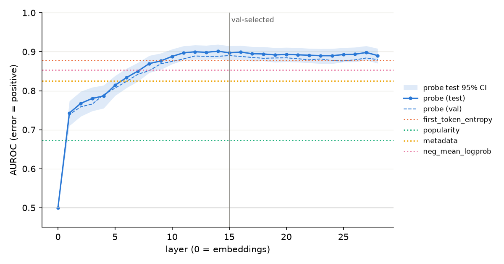
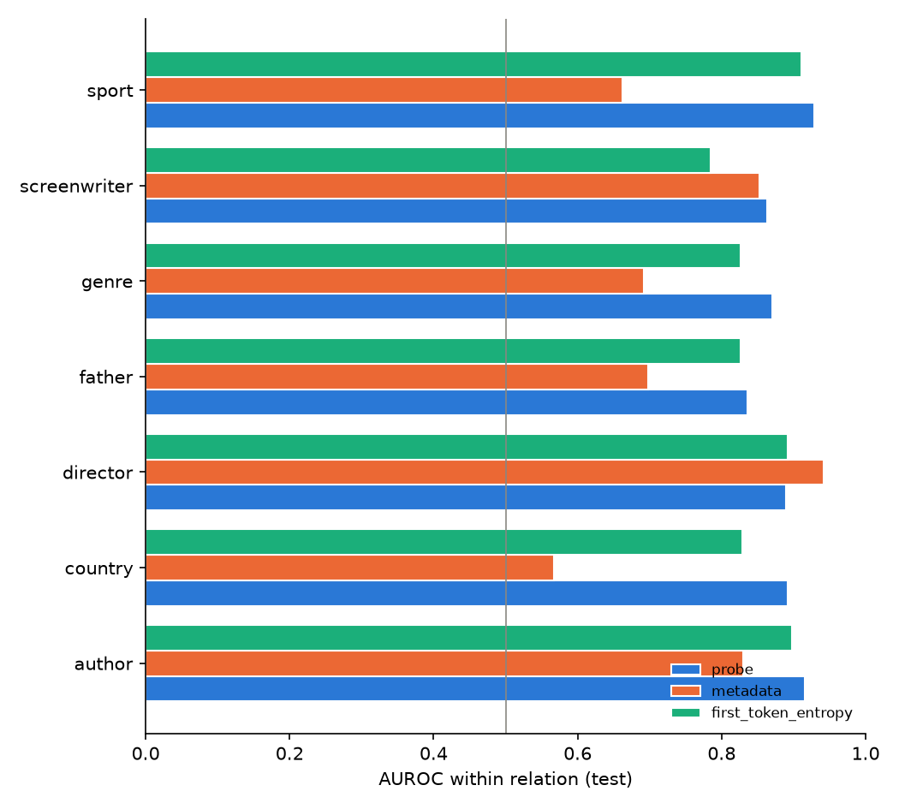
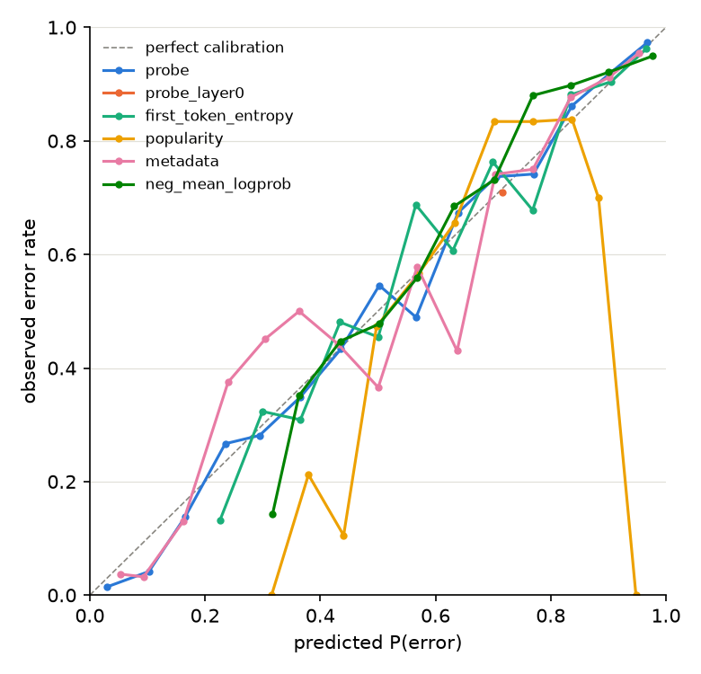
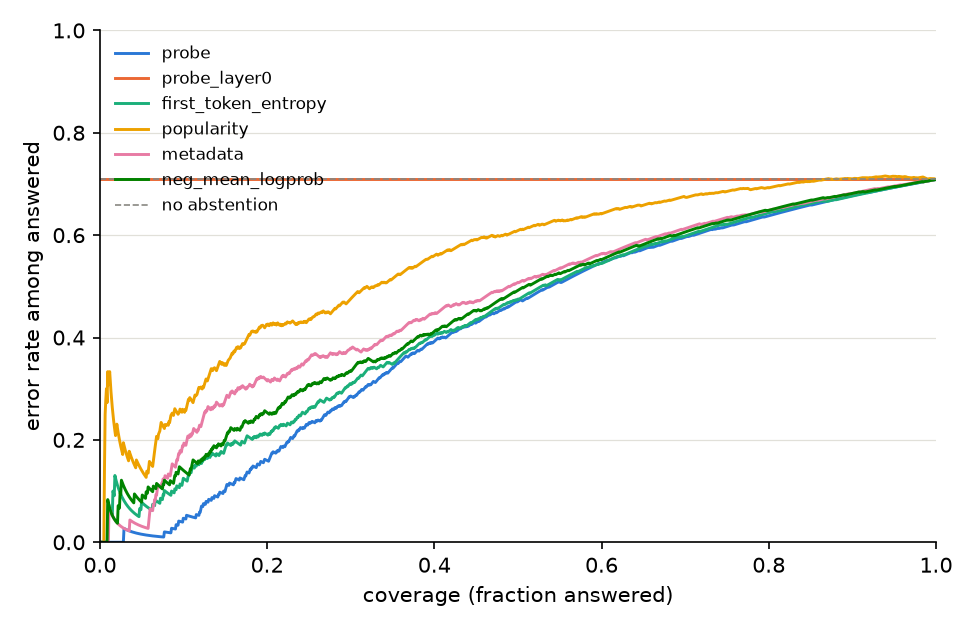

# Results: MVP (PopQA, Llama-3.2-3B-Instruct, last prompt token)

<!-- run:start -->
All numbers below come from run `20261013-204454` ([metrics.json](../results/mvp_popqa_llama3b/20261013-204454/metrics.json)).
<!-- run:end -->

## Setup recap

- **Data:** PopQA has 14,267 rows and 13,066 distinct question texts. Same-entity duplicates were merged in 296 question groups. 587 question groups whose text is shared by several entities (different `subj_id`) were dropped. That leaves 12,479 examples over 10,010 subject groups, split 8,736 / 1,896 / 1,847 (train / val / test) with no subject in two splits.
- **Labels (alias matching, rules version 2):** 2,388 correct, 6,027 incorrect, 4,064 ambiguous. Of the ambiguous answers, 3,473 are refusals, 590 partially overlap an alias, and 1 is truncated. Accuracy among unambiguous answers is 0.284. The test split has 374 correct, 910 incorrect and 563 ambiguous examples, so the headline metrics use n = 1,284 with an error base rate of 0.709.
- **Consistency check:** the argmax of the extraction pass at the last prompt token equals the first generated token for 1.000 of the 12,479 examples, so generation and extraction see identical inputs.
- **Manual review:** 100 random unambiguous examples were reviewed. Labels were pre-filled by an LLM (Claude Opus 5.5) and checked row by row by the author. 10 of the 100 were judged ambiguous on inspection, mostly same-name entities. Of the remaining 90, the automatic label disagreed in 3 cases, a **label-noise rate of 0.033**. All 3 were correct answers missing from the alias list, so they were counted as errors ([review_sample_score.json](../results/review/mvp_popqa_llama3b/review_sample_score.json), [review notes](../results/review/mvp_popqa_llama3b/review_notes.md)).

## Headline comparison

<!-- summary:start -->
| Method | Timing | AUROC [95% CI] | AUPRC [95% CI] | ECE | AURC | Risk@80% |
|---|---|---|---|---|---|---|
| probe | pre-generation | 0.897 [0.878, 0.915] | 0.951 [0.939, 0.961] | 0.021 | 0.417 | 0.638 |
| probe_layer0 | pre-generation | 0.500 [0.500, 0.500] | 0.709 [0.685, 0.731] | 0.007 | 0.709 | 0.709 |
| first_token_entropy | pre-generation | 0.878 [0.856, 0.898] | 0.941 [0.926, 0.953] | 0.035 | 0.437 | 0.644 |
| popularity | pre-generation | 0.673 [0.636, 0.708] | 0.769 [0.736, 0.803] | 0.073 | 0.548 | 0.693 |
| metadata | pre-generation | 0.826 [0.800, 0.850] | 0.907 [0.886, 0.927] | 0.045 | 0.469 | 0.649 |
| neg_mean_logprob | post-generation | 0.854 [0.830, 0.877] | 0.921 [0.902, 0.939] | 0.050 | 0.451 | 0.649 |

Test set: n = 1284, error base rate = 0.709. Probe uses layer 15 (selected on validation AUROC).
<!-- summary:end -->

The probe at the validation-selected layer 15 reaches a test AUROC of 0.897 [0.878, 0.915]. It is clearly ahead of the metadata control at 0.826 [0.800, 0.850] and of popularity alone at 0.673 [0.636, 0.708]. Against first-token entropy, which is read at the same pre-generation position, the probe's 0.897 vs 0.878 [0.856, 0.898] is **not distinguishable**: the confidence intervals overlap. The probe's interval only just clears the post-generation mean log-probability baseline at 0.854 [0.830, 0.877]. A paired test between the probe and the uncertainty baselines was not run. The layer-0 "lexical control" is exactly 0.500 by construction (see Limitations).

## Layer sweep

- **Where the signal emerges:** test AUROC rises from 0.743 at layer 1 to 0.888 at layer 10, then stays on a plateau between 0.890 and 0.901 from layer 11 to layer 28.
- **Selected layer:** validation AUROC peaks at layer 15 (0.890), which is the reported probe. The highest test value, 0.901 at layer 14, lies inside the plateau and is not reported as the result.
- **Regularisation:** for every layer from 1 to 28, validation selected C = 0.001, a strongly regularised probe.

## Shortcut controls

<!-- shortcut:start -->
| Method | Within-relation AUROC (macro) | Relations used |
|---|---|---|
| probe | 0.885 | 7 |
| probe_layer0 | 0.500 | 7 |
| first_token_entropy | 0.852 | 7 |
| popularity | 0.749 | 7 |
| metadata | 0.749 | 7 |
| neg_mean_logprob | 0.802 | 7 |

Metadata alone: AUROC 0.826; metadata + probe: 0.901; ΔAUROC 0.075 [0.055, 0.095].
<!-- shortcut:end -->

The probe is not just a popularity/relation detector:

- **Within relations:** seven relations have at least 20 test examples of each class. Inside them, the probe keeps a macro AUROC of 0.885, compared with 0.749 for the metadata model, 0.852 for first-token entropy and 0.802 for mean log-probability.
  - The metadata model stays above chance within a relation because popularity still varies there.
  - In one relation, *director*, the metadata model is ahead (0.942 vs the probe's 0.890).
- **Incremental value:** adding the probe score to the metadata model raises test AUROC from 0.826 to 0.901, a ΔAUROC of 0.075 [0.055, 0.095]. The combiner was fit on validation scores, where both inputs are out-of-sample.
- **Popularity quintiles:** the probe beats the metadata model in every s_pop quintile.

| s_pop quintile | n | error rate | probe AUROC | metadata AUROC | entropy AUROC |
|---|---|---|---|---|---|
| 1 (2–220.6) | 257 | 0.774 | 0.916 | 0.773 | 0.869 |
| 2 (220.6–931.2) | 257 | 0.844 | 0.917 | 0.762 | 0.849 |
| 3 (931.2–3,509) | 254 | 0.803 | 0.890 | 0.798 | 0.853 |
| 4 (3,509–15,644.4) | 259 | 0.699 | 0.825 | 0.771 | 0.847 |
| 5 (15,644.4–978,231) | 257 | 0.424 | 0.862 | 0.810 | 0.871 |

(Values copied from `metrics.json["shortcut"]["popularity_quintiles"]`.)

## Calibration and selective answering

- **Calibration:** the probe's predicted P(error) is the best calibrated of the informative methods, with an ECE of 0.021, compared with 0.035 for first-token entropy, 0.045 for metadata, 0.050 for mean log-probability and 0.073 for popularity. The layer-0 probe's ECE of 0.007 is trivial: it predicts the base rate for every example.
- **Selective answering:** the probe also has the lowest AURC (0.417; entropy 0.437, log-probability 0.451, metadata 0.469).
  - Because errors are the majority class here, abstention helps but cannot make the model reliable.
  - When it answers only the 50% of questions the probe considers safest, the error rate is 0.470, and at 80% coverage it is 0.638.
  - Answering every question gives an error rate of 0.709.

## Label sensitivity

<!-- sensitivity:start -->
Ambiguous test examples: 563.

| Method | Headline AUROC | Ambiguous = correct | Ambiguous = incorrect |
|---|---|---|---|
| probe | 0.897 | 0.534 | 0.914 |
| probe_layer0 | 0.500 | 0.500 | 0.500 |
| first_token_entropy | 0.878 | 0.711 | 0.853 |
| popularity | 0.673 | 0.490 | 0.705 |
| metadata | 0.826 | 0.535 | 0.854 |
| neg_mean_logprob | 0.854 | 0.770 | 0.821 |
<!-- sensitivity:end -->

This is the most important caveat. The 563 ambiguous test examples are dominated by refusals. When they count as errors, the probe improves to 0.914. When they count as correct, the probe drops to 0.534, close to chance, while mean log-probability holds at 0.770 and entropy at 0.711.

The probe gives high error scores to the questions the model goes on to refuse. What it detects is better described as "the model does not know the answer" than as "the model is about to hallucinate". Refusals and confident wrong answers look alike at the last prompt token. Telling them apart needs either a post-generation signal or a three-way target, which the MVP does not have.

## Limitations

- **Label noise:** alias matching misses correct answers whose wording is not in PopQA's alias list. The reviewed noise rate is 0.033, and all three disagreements are such false errors. About a third of all answers (4,064 of 12,479) are excluded as ambiguous, most of them refusals.
- **Review provenance:** the manual review labels were pre-filled by an LLM and checked by the author, not labelled independently from scratch.
- **Refusal rules:** the refusal phrase list was extended (rules version 2) after inspecting the model's generations. Version 1 missed most refusals ("I couldn't find any information on …") and counted them as errors. The change was made before any hidden state was extracted or any probe trained. It pushes the ambiguous share to 32.6% of all examples, above the 25% threshold the plan set for review, a trade-off the author accepted explicitly.
- **Shortcut learning:** the controls cover entity popularity and relation type only. Other surface properties of the question, such as subject-name length or tokenisation, are not controlled. Within the *director* relation the metadata model beats the probe.
- **Layer-0 control:** at the last prompt token, every prompt ends with the same assistant-header token, so the embedding-layer state is identical for all examples and the layer-0 probe is constant (AUROC 0.500). It does not work as the intended lexical control at this position. A lexical control would need to probe a question-dependent position.
- **Refusal vs error:** the probe does not separate questions the model will refuse from questions it will answer wrongly (see Label sensitivity).
- **Probe vs entropy:** the probe and first-token entropy are statistically indistinguishable on the headline AUROC. The probe's advantages are in within-relation AUROC, calibration and AURC, and those differences were not tested with a paired bootstrap.
- **Model size and scope:** one 3B model, one dataset, one prompt, closed-book short-answer QA only.
- **Platform:** inference ran in fp16 on an AMD nightly PyTorch build (TheRock, ROCm 7.14 nightly) on Windows. GPU fp16 and CPU fp32 gave identical answers and hidden-state cosine 1.0000 on the environment check.
- **Run anomalies:** generation needed no OOM back-offs. The PC crashed during the CPU probe sweep. The completed hidden-state cache was verified (all rows done, no zero or non-finite values), and the probe stage was rebuilt from scratch. A rerun from cache reproduced every number in `metrics.json` exactly. `env.json` records commit `d8139d4` with `git_dirty: true`; the dirty state comes from the run's own, then-uncommitted output directory.
